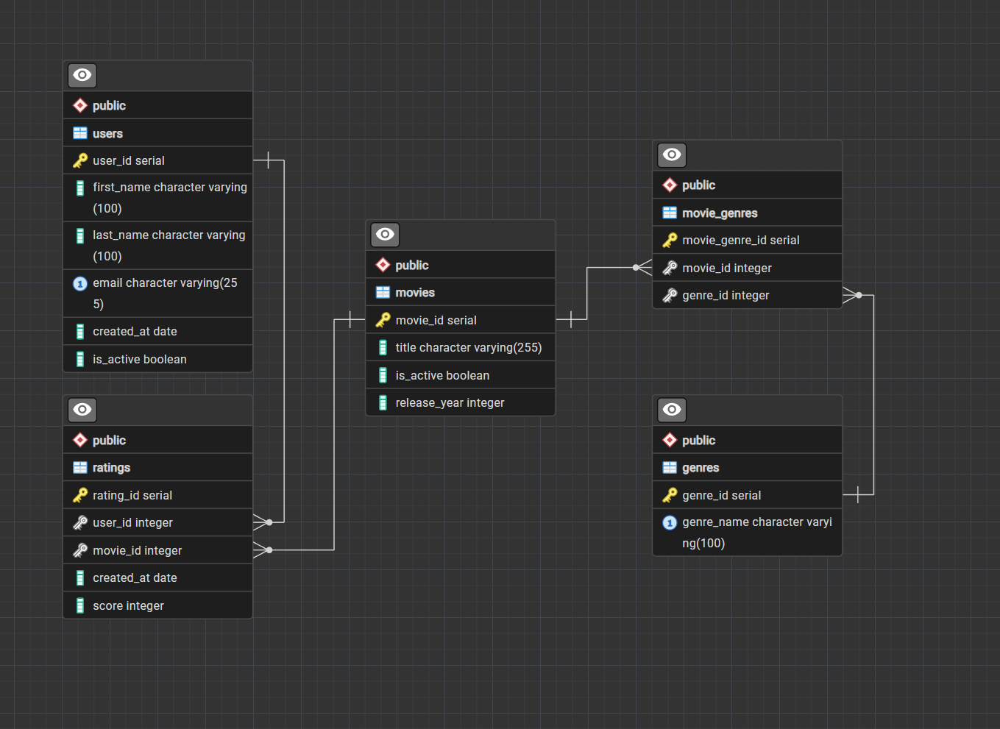

# ex603-movie-tv · Finding the real failure rate of a movie rating platform

A PostgreSQL model of a movie and TV rating platform, and the SQL analysis that found out how often its ratings fail, who is behind the failures, and whether the problem is getting better.

**Author:** Paul Astorga · **Course:** EX603 Data and Algorithms for Scalable Systems, Boston University

---

## 1. The domain

The platform lets users rate movies on a scale up to 5. Each rating is an **event**, and each movie is a **producer** of ratings. Ratings don't always stick: moderators withdraw spam and policy violations, the system catches duplicate ratings, and users can ask for their own rating to be removed. A withdrawn rating is a **failure**. The dataset covers 200 ratings from 30 users on 15 movies during 2023.

The project started from a dashboard that nobody trusted. It reported a failure count that didn't match the raw data, and a creator payout had been frozen because of it. Over the units, the work moved from fixing that number to explaining it: what the real failure rate is, which movies and users it comes from, and whether it is improving.

The platform has to answer questions like these:
- What is the real failure rate, and which numbers on the dashboard can be trusted?
- Which movies fail more than their peers, and is that the movie's fault or a few users'?
- Which movies are hidden from reports because they have no activity at all?
- Is the failure problem getting better or worse over time, and what should the team do next quarter?

## 2. Database overview



The analysis runs on the `ex603_data` database provided in Unit 3. Its DDL and data load are in [`schema/ex603_data.sql`](schema/ex603_data.sql).

| Table | What it holds | Used for |
|---|---|---|
| `ratings` | One row per rating: `rating_id`, `user_id`, `movie_id`, `rated_at`, `score`, `watch_minutes`, `device_country`, `rating_status` (`published`, `flagged`, `withdrawn`) and `withdrawn_reason` (empty unless withdrawn) | The event table. Every failure rate, trend and ranking starts here. |
| `movies` | The catalog: `title`, country, `release_year`, and whether the movie is currently available (`is_available`) | The producers. Joined to find movies with no ratings and to compare movies from the same country. |
| `users` | Accounts: `user_name`, country, email, sign-up date, and whether the account is active | Who gives the ratings, and who is behind repeated withdrawals. |
| `genres`, `movie_genres` | Genre list, and which movies belong to which genres | Testing whether the flagged movies share a genre (they don't). |
| `movie_languages` | Languages each movie is available in | Catalog context. |

Two facts about the data shaped the whole analysis:
- **`withdrawn_reason` is NULL for every rating that was not withdrawn.** A filter like `withdrawn_reason <> 'Spam detected'` silently drops those rows, which is exactly what broke the original dashboard.
- **Every withdrawn rating has a placeholder score of 0.5.** Averages leave withdrawn ratings out, or movies with many withdrawals look worse than they are.

<details>
<summary>Earlier design: the schema I designed in Assignment 2</summary>

Before the course dataset, I designed my own version of the schema ([`schema/schema.sql`](schema/schema.sql), ERD in [`schema/ERDUpdatedAssignment2.png`](schema/ERDUpdatedAssignment2.png)). It stores users, a movie catalog, genres and ratings.

| Table | Purpose | Primary key |
|---|---|---|
| `users` | Platform accounts: name, email, sign-up time, and whether the account is active. | `user_id` |
| `movies` | The movie catalog: title, release year, and whether the movie is listed. | `movie_id` |
| `genres` | The reference list of genres, such as `comedy` or `drama`. | `genre_id` |
| `movie_genres` | Links movies to genres. A movie can have several genres, and a genre covers many movies. | `(movie_id, genre_id)` |
| `ratings` | A user's 1–5 score for a movie, with the time it was given. | `(user_id, movie_id)` |

```
users ──< ratings >── movies ──< movie_genres >── genres
```

Design decisions:
- **Soft deletes with `is_active`.** Users and movies are deactivated, not deleted. This keeps ratings and movie averages stable when an account closes or a title is delisted. A hard `DELETE` is reserved for entries that should never have existed, such as duplicates.
- **Composite primary keys instead of surrogate IDs.** `movie_genres` and `ratings` are keyed on the pair of IDs they connect. That makes it impossible to tag a movie with the same genre twice or for a user to rate the same movie twice, without needing a separate `UNIQUE` constraint.
- **Deliberate `ON DELETE` rules.** Deleting a movie cascades to its genre links and ratings. Deleting a genre is blocked (`RESTRICT`) while any movie still uses it. Deleting a user who has ratings is blocked; deactivate them instead.
- **Case-insensitive uniqueness through lowercase storage.** `users.email` and `genres.genre_name` are `UNIQUE` and must be lowercase, which prevents duplicates like `Ana@Mail.com` and `ana@mail.com`.
- **Range checks on numbers.** `release_year` must be between 1888 and 2100, and `score` between 1 and 5.
- **IDs are supplied explicitly.** `user_id`, `movie_id` and `genre_id` are plain `INT` primary keys.

The reasoning behind every foreign key and `CHECK` constraint is in [`analysis/unit2.md`](analysis/unit2.md) and [`schema/constraints.md`](schema/constraints.md).

</details>

## 3. Query catalogue

Each unit's SQL is in `queries/unitN/`. Write-ups are in [`analysis/`](analysis/), and each unit ends with a memo to leadership (`unitN-finding.md`).

### Unit 3 – Filtering, NULLs and subqueries · [memo](analysis/unit3-finding.md)

| Query | Business question |
|---|---|
| [`q3_1.sql`](queries/unit3/q3_1.sql) · active producers | Which available movies released after 2015 are rated highest? (top 10) |
| [`q3_1.sql`](queries/unit3/q3_1.sql) · statuses | Which rating statuses exist in the data? |
| [`q3_1.sql`](queries/unit3/q3_1.sql) · filters | Which ratings fall in a score range, or in a list of statuses (`IN`)? |
| [`q3_1.sql`](queries/unit3/q3_1.sql) · text and NULLs | Which movies match a title pattern (`LIKE`), and which withdrawn ratings have no reason (`COALESCE`)? |
| [`q3_1.sql`](queries/unit3/q3_1.sql) · readable report | What does each rating look like in plain language (date, time of day, rating category, watch time and status, with `CASE`)? |
| [`q3_2.sql`](queries/unit3/q3_2.sql) · Part A | How many ratings were *not* removed for spam? (The dashboard said 22; the real answer is 188.) |
| [`q3_2.sql`](queries/unit3/q3_2.sql) · Part B | Why does an alias defined in `SELECT` fail in `WHERE`, and how do you fix it? |
| [`q3_3.sql`](queries/unit3/q3_3.sql) | Which ratings were withdrawn, and who gave them? Written three ways (`IN`, CTE, `EXISTS`) and proven identical. |

### Unit 4 – Aggregation · [write-up](analysis/unit4.md) · [memo](analysis/unit4-finding.md)

| Query | Business question |
|---|---|
| [`q4_1.sql`](queries/unit4/q4_1.sql) · 4.1.1 | What do ratings look like across the whole platform, and how many users are rating? |
| [`q4_1.sql`](queries/unit4/q4_1.sql) · 4.1.2 | Which movies get the most ratings, and how well do they score? |
| [`q4_1.sql`](queries/unit4/q4_1.sql) · 4.1.3 | Which movies have enough ratings (10+) for their failure rate to be meaningful, and what is that rate? (`HAVING`) |
| [`q4_1.sql`](queries/unit4/q4_1.sql) · 4.1.4 | How does each movie perform in each country? |
| [`q4_2.sql`](queries/unit4/q4_2.sql) · 4.2.A | How many ratings did each movie receive, and how many failed? (conditional aggregation) |
| [`q4_2.sql`](queries/unit4/q4_2.sql) · 4.2.B | What is the failure rate in each country, and for the platform as a whole? (`ROLLUP`) |
| [`q4_2.sql`](queries/unit4/q4_2.sql) · 4.2.C | What is the typical failure rate for movies with 10+ ratings? (CTE baseline) |

### Unit 5 – Joins · [write-up](analysis/unit5.md) · [memo](analysis/unit5-finding.md)

| Query | Technique | Business question |
|---|---|---|
| [`q5_1.sql`](queries/unit5/q5_1.sql) · 1 | `INNER JOIN` (3 tables) | Who gave each rating, for which movie, and when? |
| [`q5_1.sql`](queries/unit5/q5_1.sql) · 2 | `INNER JOIN` through `movie_genres` | Do the flagged movies (2, 9, 11) share any genres? |
| [`q5_1.sql`](queries/unit5/q5_1.sql) · 3 | Self join on `movies` | How do the flagged movies compare with other movies from the same country? |
| [`q5_2.sql`](queries/unit5/q5_2.sql) · A.1–A.4 | `LEFT` vs `INNER JOIN`, `IS NULL` | How many ratings does every movie have, and which movies have never been rated? |
| [`q5_2.sql`](queries/unit5/q5_2.sql) · B.1–B.3 | `RIGHT JOIN`, `EXCEPT`, `FULL OUTER JOIN` | Do both join directions agree, and are there ratings without a movie? |
| [`q5_2.sql`](queries/unit5/q5_2.sql) · C.1–C.2 | `NOT EXISTS`, `EXCEPT` | Which movies have never been rated? (two more ways) |
| [`q5_3.sql`](queries/unit5/q5_3.sql) · A | `CROSS JOIN` | What does every movie × genre pair look like (15 × 5 = 75)? |
| [`q5_3.sql`](queries/unit5/q5_3.sql) · B | `EXPLAIN ANALYZE` | How does PostgreSQL run the three-table join, and how fast is it? |

### Unit 6 – Window functions · [write-up](analysis/unit6.md) · [memo](analysis/unit6-finding.md)

| Query | Technique | Business question |
|---|---|---|
| [`q6_1.sql`](queries/unit6/q6_1.sql) · Part 1 | `AVG() OVER (PARTITION BY)` vs `GROUP BY` | Which ratings are unusual for their own movie? |
| [`q6_1.sql`](queries/unit6/q6_1.sql) · Part 2 | `ROW_NUMBER`, `RANK`, `DENSE_RANK` | How does tie handling change a "Most Rated" leaderboard? |
| [`q6_1.sql`](queries/unit6/q6_1.sql) · Part 3 | `NTILE(4)` | Which band does each movie fall into, and what happens to ties at a band boundary? |
| [`q6_2.sql`](queries/unit6/q6_2.sql) · Part A | `LAG`, `LEAD` | Is a movie's score trending up or down? (movie 11) |
| [`q6_2.sql`](queries/unit6/q6_2.sql) · Part B | Running `SUM`, moving `AVG` | How is the platform doing month by month, and against a quarterly target? |
| [`q6_2.sql`](queries/unit6/q6_2.sql) · Part C | `LAG` on timestamps | Which movie stopped receiving ratings for a long time? (movie 9, 112 days) |
| [`q6_3.sql`](queries/unit6/q6_3.sql) · Part A | Top N per group, `FIRST_VALUE`, `LAST_VALUE` | What are each movie's three best ratings? |
| [`q6_3.sql`](queries/unit6/q6_3.sql) · Part B | `LAG` on a `generate_series` calendar, `NULLIF` | Is the failure rate getting better or worse each month? |
| [`q6_4.sql`](queries/unit6/q6_4.sql) · M1–M4 | Quarterly trends, reasons, movies, users | The evidence for the closing memo. |

## 4. Technical highlights

1. **NULL-aware filtering (Unit 3).** `withdrawn_reason` is NULL for every rating that wasn't withdrawn, and `NULL <> 'Spam detected'` is UNKNOWN, not TRUE, so `WHERE` silently drops those rows. That is why the dashboard reported 22 "not spam" ratings instead of 188. Adding an explicit `IS NULL` (or `COALESCE`) fixed the number behind the frozen payout.
2. **Conditional aggregation (Unit 4).** `COUNT(*) FILTER (WHERE rating_status = 'withdrawn')` computes the total and the failures in a single pass over `ratings`. Two separate queries would read the table twice and could describe different snapshots, which is how wrong failure rates happen.
3. **Outer joins and anti-joins (Unit 5).** An `INNER JOIN` from movies to ratings returns 13 movies, and a `LEFT JOIN` returns 15. Movies 14 and 15 have no ratings, so they never appear in failure reports. `LEFT JOIN ... IS NULL`, `NOT EXISTS` and `EXCEPT` all find them.
4. **Window functions (Unit 6).** `LAG` compares each rating with the previous one without collapsing rows, which found movie 9's 112-day gap. A running `SUM` showed *when* the failure rate improved, and `RANK` vs `ROW_NUMBER` showed how tie handling decides who appears first on a leaderboard.
5. **Reading the execution plan (Unit 5).** `EXPLAIN ANALYZE` showed a Hash Join and a Nested Loop with Memoize (13 cache misses, 187 hits, 0.213 ms), and that `ratings` has no index on `user_id`, `movie_id` or `rated_at`. Those indexes are the first step if the platform grows.

## 5. Findings and recommendations

**1. The real failure rate is 17%, and the original dashboard was wrong.** 34 of 200 ratings were withdrawn. The dashboard's "not spam" count missed 166 normal ratings because of a NULL comparison (Unit 3).
→ *Recalculate the frozen payout with the corrected count, and treat an empty `withdrawn_reason` as "not withdrawn" in every report.*

**2. The problem improved, then stopped improving.** The failure rate fell from **22.6% in Q1 2023 to about 15%** in Q2–Q4, because spam and policy violations halved. Duplicates and user requests did not change and are now about half of all failures (Unit 6).
→ *Block duplicate ratings in the app. On Q4's numbers, that alone brings the rate from 14.6% to 10.4%. Report user requests separately, since they are not a platform failure. Target: below 12% next quarter.*

**3. Failures are concentrated, so act on causes, not producers.** Three users (8, 16 and 23) are behind **29.4%** of all withdrawals. Movies 11 and 2 improved in the second half of the year, but **movie 9 got worse (14.3% → 42.9%)**, had a 112-day gap with no ratings, and is now unlisted. Movies 14 and 15 have never been rated (Units 5 and 6).
→ *Review the three repeat users, investigate movie 9 before listing it again, and check whether users can find movies 14 and 15.*

## 6. Limitations and future improvements

**The data only stores the current state, not its history.** `movies.is_available` says whether a movie is available *today*, and `ratings` records a rating but not what happened around it. That is why the analysis could find movie 9's 112-day gap but couldn't explain it: the movie may have been unlisted during those months, or people may simply have stopped rating it. Missing ratings leave no row, so "no activity" and "activity we didn't record" look the same.

The sample is also small: 200 ratings over one year, so one withdrawn rating moves a quarter's failure rate by about two points.

What would help:
- **A listing-history table** (`movie_id`, `listed_from`, `listed_to`) to tell a real drop in interest from a movie that wasn't available.
- **More time and more ratings,** so that quarter-to-quarter changes can be separated from noise.
- **Views or impressions per movie,** so a movie with no ratings can be told apart from a movie nobody saw.

## 7. Video presentation

▶️ **[Watch the project presentation]https://youtu.be/l-Lpx0gH78Y**

## 8. How to run it

You need PostgreSQL 14 or later and `psql`. Nothing else.

**1. Create the database:**

```bash
createdb ex603_data
```

**2. Create the tables and load the data** (the DDL and data provided in Unit 3):

```bash
psql -d ex603_data -f schema/ex603_data.sql
```

**3. Check the load** (expect 200 ratings, 34 withdrawn):

```bash
psql -d ex603_data -c "SELECT COUNT(*) AS ratings, COUNT(*) FILTER (WHERE rating_status = 'withdrawn') AS withdrawn FROM ratings;"
```

**4. Run any query file**, for example the evidence behind the closing memo:

```bash
psql -d ex603_data -f queries/unit6/q6_4.sql
```

Each `.sql` file starts with a comment that says which task it answers and the business question behind it. Most files also list the expected results, so you can check your output against them.